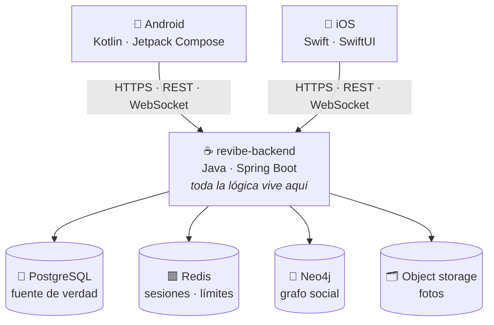

<div align="center">

# ✨ Revibe

### Vive los planes. Comparte los recuerdos. Divide los gastos.

**La red social de las experiencias que vivimos juntos.**

<br/>


</div>

---

## 🌍 ¿Qué es Revibe?

Revibe no es otra app para publicar fotos. Es una plataforma centrada en **lo que vivimos con otras personas**: salir, viajar, ir de fiesta, organizar un plan y conocer gente.

Todo el ciclo de un plan, en una sola app:

```
   🗓️ Crear o descubrir   →   👥 Juntar a la gente   →   💬 Organizarse
            ↓                                                  ↓
   📸 Compartir recuerdos   ←   💸 Repartir gastos   ←   🎉 Vivirlo
```

---

## 🚀 Funcionalidades

<table>
<tr>
<td width="50%" valign="top">

### 🗓️ Planes y eventos
Crea planes **privados**, **para amigos** o **públicos**. Invita a gente, gestiona roles (*owner*, *admin*, *member*) y pon límite de plazas.

### 💸 Gastos compartidos
Apunta quién ha pagado qué y cómo se reparte. Revibe calcula **quién le debe a quién**, con precisión al céntimo.

### 📸 Álbumes con desbloqueo
Cada plan tiene su álbum. Las fotos pueden quedar **ocultas hasta una fecha**, como un carrete que se revela después.

</td>
<td width="50%" valign="top">

### 👥 Amigos y seguidores
Amistad mutua por solicitud y seguimiento unidireccional, cada uno con su propio papel.

### 🔎 Descubrimiento social
**Planes de amigos de amigos**, personas que quizá conozcas y recomendaciones según tus gustos.

### 💬 Chat del plan
Cada evento tiene su propio chat de grupo en tiempo real.

### 🔔 Notificaciones y 🛡️ seguridad
Notificaciones push, bloqueos, denuncias y moderación.

</td>
</tr>
</table>

---

## 🏗️ Arquitectura



| Pieza | Para qué |
|---|---|
| 🐘 **PostgreSQL** | Fuente de verdad: usuarios, planes, gastos, fotos, chat… |
| 🟥 **Redis** | Sesiones, códigos temporales, límite de peticiones y tiempo real |
| 🔵 **Neo4j** | Grafo social para descubrimiento y recomendaciones |
| 🗂️ **Object storage** | Fotos privadas servidas con URLs firmadas |

> **Principio clave:** las apps nunca tocan una base de datos. Todo pasa por la API, y la API es la que decide qué puede ver cada uno.

---

## 📦 Repositorios

| Repositorio | Descripción | Stack |
|---|---|---|
| [`revibe-backend`](../revibe-backend) | API REST, autenticación y lógica de negocio | ☕ Java · Spring Boot |
| [`revibe-android`](../revibe-android) | App nativa de Android | 🤖 Kotlin · Jetpack Compose |
| [`revibe-ios`](../revibe-ios) | App nativa de iOS | 🍎 Swift · SwiftUI |

---

## ⚡ Arranque rápido (backend)

```bash
# 1. Clonar
git clone https://github.com/<org>/revibe-backend.git
cd revibe-backend

# 2. Variables de entorno
cp .env.example .env

# 3. Levantar PostgreSQL, Redis y Neo4j
docker compose up -d

# 4. Arrancar el backend (Flyway crea las tablas solo)
./mvnw spring-boot:run
```

¿Trabajas en las apps y no quieres tocar Java? Levántalo todo, backend incluido:

```bash
docker compose --profile full up -d --build
```

| Desde | URL de la API |
|---|---|
| Emulador de Android | `http://10.0.2.2:8080` |
| Simulador de iOS | `http://localhost:8080` |
| Móvil físico | `http://<IP-de-tu-ordenador>:8080` |

---

## 🔐 Seguridad y privacidad

- 🔑 Contraseñas con **Argon2id/bcrypt**, códigos y tokens guardados **hasheados**
- 🎟️ Sesiones con **token opaco** y revocación inmediata
- 🛡️ **2FA** opcional, con el secreto cifrado
- 📍 Se **eliminan los datos GPS (EXIF)** de todas las fotos
- 🚫 Bloqueos y visibilidad comprobados en **cada lectura**
- 🤫 Ningún secreto en git: `.env` fuera del repositorio

---

## 🤝 Cómo trabajamos

<details>
<summary><b>🌿 Ramas</b></summary>

<br/>

| Rama | Uso |
|---|---|
| `main` | Siempre estable y desplegable |
| `develop` | Integración del trabajo en curso |
| `feature/<nombre>` | Nuevas funcionalidades |
| `fix/<nombre>` | Corrección de errores |

</details>

<details>
<summary><b>✍️ Commits (Conventional Commits)</b></summary>

<br/>

```
feat: añadir creación de planes
fix: corregir cálculo de balances
refactor: extraer AccessPolicy
docs: actualizar README
chore: actualizar dependencias
```

</details>

<details>
<summary><b>🔍 Pull requests</b></summary>

<br/>

- Todo entra por pull request, nunca directamente a `main`
- Al menos **una revisión** de otra persona del equipo
- Los tests tienen que pasar
- Las migraciones de base de datos se revisan con especial cuidado

</details>

<details>
<summary><b>🗄️ Base de datos</b></summary>

<br/>

- Cada cambio de esquema es una **migración de Flyway** nueva (`V8__...sql`)
- Una migración que ya se ha aplicado **no se modifica nunca**
- Nada de `ddl-auto=update`

</details>

---

## 🗺️ Roadmap

- [x] Definición del producto y del modelo de datos
- [x] Arquitectura y stack
- [ ] 🔐 Registro, login y sesiones
- [ ] 👥 Amistades, seguidores y bloqueos
- [ ] 🗓️ Planes y participantes
- [ ] 💸 Gastos compartidos
- [ ] 📸 Álbumes y fotos
- [ ] 💬 Chat del plan
- [ ] 🔔 Notificaciones push
- [ ] 🔎 Descubrimiento con Neo4j
- [ ] 🚀 Beta cerrada
- [ ] 📲 Lanzamiento en Play Store y App Store

---

<div align="center">

### 👋 El equipo

*Hecho con ☕, código y muchas ganas de hacer planes.*

<br/>

**Revibe** © 2026 · Todos los derechos reservados

</div>
